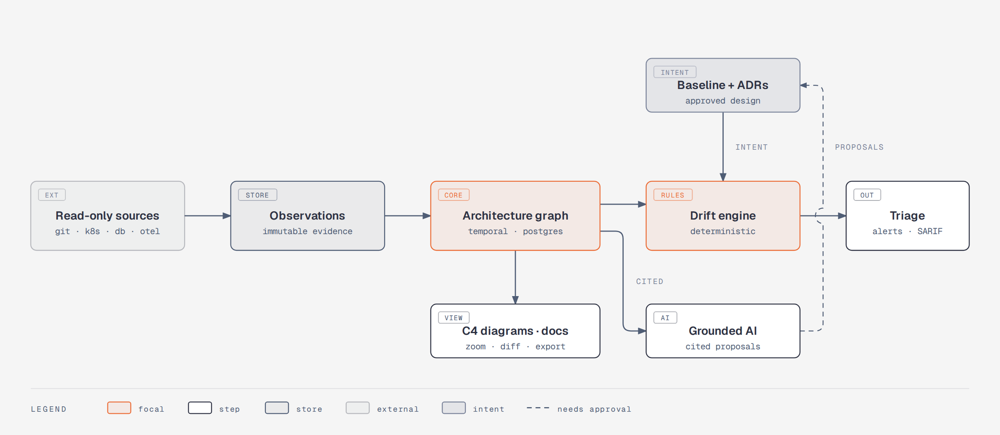
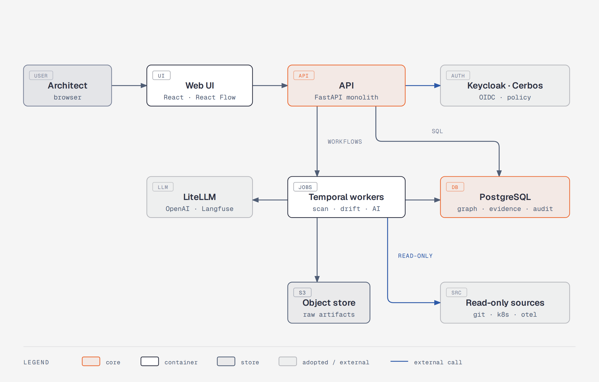

<div align="center">


# ArchTwin

**The living digital twin of your software architecture.**
Know what was designed, what was planned, what the code says and what is actually running — and get told, with evidence, when they drift apart.

[](#-roadmap--status)
[](openspec/)
[](docs/TECHNOLOGIES.md)
[](docs/TECHNOLOGIES.md)
[](docs/architecture/adr/0002-postgresql-canonical-store-and-outbox.md)
[](docs/architecture/adr/0007-temporal-for-all-durable-work.md)
[](docs/architecture/adr/0004-keycloak-cerbos-and-federation.md)
[](docs/ai/AI_ARCHITECTURE.md)

[What it is](#-what-it-is) · [Quick start](#-quick-start) · [Features](#-features) · [How it works](#-how-it-works) · [Architecture](#-architecture) · [Tech stack](#-tech-stack) · [Roadmap](#-roadmap--status) · [Docs](#-documentation) · [Contributing](#-contributing)

</div>

---

> [!NOTE]
> **Status:** the walking skeleton and the M1/M2 vertical slice are implemented and tested end to end (phases 01–04 MVP scope plus the
> grounded assistant from phase 06, M1 data-source connectors and a personal home dashboard) on branch `feat/walking-skeleton-m1`. Live progress per task: [`docs/TASKS.md`](docs/TASKS.md).
> OpenSpec task checkboxes are ticked only after merge with green CI. Phases 05 and 07 are specified, not implemented.

## 🚀 Quick start

```bash
./scripts/init-env.sh sk-your-openai-key   # writes .env, generates every internal secret (omit the key for zero-token fake LLM mode)
make up                                     # docker compose up -d --build (first start migrates and seeds)
open http://localhost:3200                  # admin/admin · alice, bob, vera, mallory / archtwin
```

The fastest way to see every connector working is the reference fixture (a separate Compose project):

```bash
make fixtures-up      # OTel-instrumented shop: web, orders, inventory, billing + Kafka, Schema Registry, PostgreSQL, MySQL, Prometheus
make fixtures-demo    # creates "Shop (reference fixture)" with git, Docker, OTel, PostgreSQL, MySQL and Kafka connectors and scans them
```

Or by hand: **New project → Datasources → Add datasource** (a local directory, `github`, `gitlab`, `taiga`, `docker`,
`otel_servicegraph`, `postgresql`, `mysql`, `kafka`, `http_openapi`) → **Scan** → **Architecture** (C4 zoom: double-click / Enter, Backspace to go up) → **Settings → Propose
baseline** (a different user approves) → **Drift** → **Assistant**.

### Your own sources: local directories, GitLab, Taiga

```bash
# .env — then `make up`
ARCHTWIN_SOURCE_WORKSPACE=/home/me/workspace/myproduct     # absolute; mounted read-only at the SAME path
ARCHTWIN_EGRESS_ALLOW_PRIVATE_HOSTS=gitlab.internal,taiga.internal   # self-hosted providers on 10.x / 172.16-31.x / 192.168.x
ARCHTWIN_EGRESS_INSECURE_TLS_HOSTS=taiga.internal          # only if a host has a self-signed / wrong-CN certificate
```

- **Local directory** — *Browse…* opens a folder picker over the mounted roots. A single repository is scanned at any ref; a
  folder of repositories (e.g. `myproduct/backend`) scans each repository as its own system; set `content: docs` for
  documentation or architecture folders (every Markdown/text file, ADRs anywhere, Mermaid/PlantUML/Structurizr sources;
  PDF/DOCX with the `documents` profile). Add as many directories to one project as you like.
- **GitLab** — paste project URLs (`https://gitlab.internal/group/sub/project`) or whole `groups`; the dialog links to the
  token page pre-filled with `read_api` + `read_repository`. Commits, branches, issues and merge requests; push webhooks scan
  only the pushed project.
- **Taiga** — paste the board URL (`https://taiga.internal/project/<slug>/kanban`); anonymous for public projects, otherwise a
  read-only user's username + password (or a token). Epics, stories, tasks, issues and sprints become work items.

| Container | Role | Port |
|---|---|---|
| `archtwin-web` | React UI (nginx, CSP, `/api` proxy) | 3200 |
| `archtwin-api` | FastAPI modular monolith | 127.0.0.1:8200 |
| `archtwin-worker` | Temporal worker + outbox relay + reconcile loop | — |
| `archtwin-migrate`, `archtwin-seed` | Alembic migrations, pilot-org seed (one-shot) | — |
| `archtwin-thirdparty-postgres` | PostgreSQL + pgvector (system of record, RLS) | 127.0.0.1:5452 |
| `archtwin-thirdparty-keycloak` | OIDC (PKCE) | 8280 |
| `archtwin-thirdparty-cerbos` | authorization PDP | — |
| `archtwin-thirdparty-temporal`, `-temporal-ui` | durable jobs | 127.0.0.1:8253 |
| `archtwin-thirdparty-litellm` | the only AI egress (gpt-6-luna / terra / sol) | 127.0.0.1:4200 |
| `archtwin-thirdparty-langfuse-web`, `-worker`, `-clickhouse` | LLM traces | 127.0.0.1:3201 |
| `archtwin-thirdparty-valkey`, `-seaweedfs` | cache / S3 object store | — |
| `archtwin-thirdparty-docker-proxy` | read-only Docker API for runtime discovery | — |
| `archtwin-thirdparty-docling` | PDF/DOCX parsing (profile `documents`) | — |

Tests: `make test` (unit) · `make test-integration` (RLS) · `make test-e2e` (API journeys on the live stack) · `make test-ui` (Playwright + axe) ·
`make policy-test` (Cerbos) · `make spec-validate` (OpenSpec) · `make coverage` (all suites with the API and worker instrumented; fails under 90 %).

## ✨ What it is

Architecture documentation rots the day it is written. Diagrams, ADRs, Jira tickets, code and Kubernetes all evolve separately, and architects find out about drift in production.

ArchTwin closes the **architectural continuity loop**:

```
Design → ADR → plan → issues / commits → runtime observation → drift → review → updated architecture
```

- 🔎 It **discovers** systems, services, APIs, topics, databases and workloads from GitHub/GitLab, Kubernetes, PostgreSQL, Kafka, OpenTelemetry and your documents — read-only.
- 🧾 Every fact carries **evidence**: where it came from, which revision, when it was observed, how confident we are. Missing data is shown as **unknown**, never as "deleted".
- 🗺 It renders **C4 diagrams** you can edit, review, diff and export — and lets you **zoom** from system context into containers and components.
- 🚨 It **detects drift** deterministically between what was decided, what the code says and what is running.
- 🤖 It answers questions like **"How do I connect platform A and B?"** with cited options, trade-offs, diagrams and an ADR draft — without ever changing anything on its own.

## 🧩 Features

### Projects and security
- **Independent projects** with their own people, environments, connectors, baselines and AI budget; cross-project access only through explicit, expiring **federation grants**.
- **Keycloak** single sign-on, **Cerbos** policy-as-code on every read and write (list filtering included), PostgreSQL row-level security as defence in depth.
- **Hash-chained audit log** with an export verifier; envelope-encrypted connector secrets that never reach browsers, logs or prompts.
- **Feature flags** for every optional module, connector and AI operation, with an emergency kill switch — security invariants are never flaggable.

### Discovery and evidence
- Connectors for **local directories (single repos, folders of repos, docs/architecture folders), GitHub, GitLab, Taiga, Docker, PostgreSQL/MySQL, Kafka + Schema Registry, OpenAPI, OpenTelemetry service graph** and uploaded documents (Docling); Kubernetes and Jira are planned in the [connector matrix](docs/connectors/CONNECTOR_MATRIX.md).
- Code extraction from declared artifacts first (OpenAPI, AsyncAPI, Helm, Backstage `catalog-info.yaml`, CODEOWNERS), plus tree-sitter detectors and Syft SBOMs — every finding with file, line and commit.
- Webhooks + watches + scheduled reconciliation; partial scans never cause false deletions.

### Living architecture
- One canonical, **temporal** architecture graph: time-travel to any date, diff any two snapshots, approve immutable **baselines**.
- **Diagram studio**: C4 context / container / component, deployment, data-flow and sequence views from the same model; manual layout survives regeneration; Structurizr DSL and Mermaid import/export.
- **Animated C4 zoom**: dive from the system context (L1) into a system's containers (L2) and a container's components (L3), with breadcrumbs and reduced-motion support.
- **Editorial diagram quality**: every generated diagram follows the open-source [diagram-design](https://github.com/cathrynlavery/diagram-design) system — org-branded tokens, at most two focal accents, ≤ 9 primary nodes per view, orthogonal connectors — checked by a linter before export.
- **ADRs** (MADR) with independent approval and immutable history; **living documentation** where every generated sentence cites its evidence.
- **Exports** from Architecture, Flows, Drift, Decisions and Docs: Markdown (canonical, diagrams as Mermaid), Word (.docx), PDF or a ZIP bundle (every item, all formats and a `manifest.json` with project, snapshot and source revisions) — same permissions as the page, audited (`GET /api/v1/projects/{id}/export/{resource}?format=md|docx|pdf|zip`).

### Drift and delivery
- **Three-way drift**: desired (baseline/ADR) vs code vs runtime, with `unknown` / `incomplete` states, grace windows and an observe-only rollout to keep false positives down.
- Triage workflow, scoped and expiring suppressions (reasons optional), **delete** a finding you consider untrue (dismissed as a false positive, never resurrected by re-evaluation, restorable) — one at a time or every open finding of a rule. Re-keyed elements and inferred external dependencies never raise "X is no longer observed".
- Notifications to email, Slack, Teams or webhooks (Apprise).
- **Traceability** from initiative → issue → PR → commit → build → image digest → running workload: *Done in Jira* is never confused with *deployed*.
- Architecture checks for CI as signed **SARIF** reports — report-only first, blocking only with deterministic rules and owner approval.

### Grounded AI
- Architecture assistant over **scoped evidence only**, with citations validated against an evidence pack; unsupported claims are marked.
- **Per-task model routing** through LiteLLM ([`MODEL_PROFILES.yaml`](docs/ai/MODEL_PROFILES.yaml)): architecture drafts, flow search, drift review and integration design run on `gpt-6-terra` with **high** reasoning; grounded answers and ADRs on `gpt-6-luna`/medium; rewriting and page search on `gpt-6-luna`/low. `gpt-6-sol` is blocked. A model the provider rejects is hidden and its tasks fall back to Luna with the same reasoning effort. Evidence is trimmed to each task's token budget.
- **Cost estimates before every AI call** (tokens and USD expected / high / worst case, learned from the last 30 days of the usage ledger) and a *Model routing per task* table on the Usage page; every answer shows the model and its cost.
- **Ask a page**: chat-like search on Flows ("what is the flow of dissemination documents?"), Decisions ("is caching part of any decision?") and Docs. Search runs first and costs nothing; a short cited AI answer is added on top and cached for identical questions.
- **Integration designer** for "connect A and B": at least two options, a trade-off matrix, C4 and sequence diagrams, ADR and task drafts.
- **Blast-radius analysis** and what-if scenarios on isolated branches of the model.
- Proposals only: nothing is applied, written to a tracker or deployed without explicit, authorized approval.

## 🔄 How it works

<p align="center"></p>

## 🏗 Architecture

A **modular monolith** (FastAPI) plus **Temporal** workers from the same image, with **PostgreSQL** as the only system of record. Everything else is adopted open source.

<p align="center"></p>

<sub>More views: <a href="docs/diagrams/system-context.png">C4 system context</a> · <a href="docs/diagrams/drift-sequence.png">drift detection sequence</a> · <a href="docs/diagrams/ai-design-sequence.png">grounded AI sequence</a>. All diagrams are built with the <a href="https://github.com/cathrynlavery/diagram-design">diagram-design</a> system — sources in <a href="docs/diagrams/"><code>docs/diagrams/</code></a>.</sub>

Key decisions are recorded as ADRs in [`docs/architecture/adr`](docs/architecture/adr/README.md): modular monolith, PostgreSQL + outbox (no Kafka in MVP), three-way evidence model, Keycloak + Cerbos, LiteLLM with selectable models, read-only connectors, Temporal, OpenFeature flags, the diagram-design system with C4 zoom, and *adopt open source before building*.

## 🧰 Tech stack

| Layer | Choices |
|---|---|
| Backend | Python, FastAPI (asyncio), Pydantic v2, SQLAlchemy 2 async, Alembic |
| Data | PostgreSQL (graph tables, JSONB, FTS, pgvector), Valkey, S3-compatible storage (SeaweedFS) |
| Workflows | Temporal, transactional outbox |
| Identity & policy | Keycloak (OIDC + PKCE), Cerbos, OpenFeature, OpenBao (optional KMS) |
| Discovery | githubkit, python-gitlab, kubernetes_asyncio, confluent-kafka, tree-sitter, Syft, Docling, OpenTelemetry |
| Frontend | React 19, Vite, TypeScript, TanStack, shadcn/ui, Tailwind, React Flow, elkjs, Motion |
| Diagrams | diagram-design system, Mermaid & Structurizr (interchange) |
| AI | LiteLLM, Langfuse, OpenAI (`gpt-6-luna` default, `gpt-6-terra`, `gpt-6-sol`) |
| Ops | Docker Compose, Helm, CloudNativePG, Prometheus, Grafana, OpenTelemetry |

Full adopt-vs-build reasoning: [`docs/TECHNOLOGIES.md`](docs/TECHNOLOGIES.md).

## 🗺 Roadmap & status

| Phase | Increment | Milestone | Status |
|---|---|---|---|
| [01](openspec/changes/phase-01-foundation/) | Secure multi-project foundations (walking skeleton) | M1 | ✅ MVP implemented (OTel tracing, OpenBao, org deletion, break-glass: later) |
| [02](openspec/changes/phase-02-connectors/) | Discovery and connected evidence | M1 | 🚧 mostly: local directories (repos, folders of repos, docs) + Git HTTPS, GitHub, GitLab, Taiga, Docker runtime, OTel service graph, PostgreSQL/MySQL catalogs, Kafka + Schema Registry, live OpenAPI, uploads, signed webhooks; Kubernetes (deferred: Docker-only for now), Jira, Syft SBOM open |
| [03](openspec/changes/phase-03-architecture/) | Living diagrams, C4 zoom, docs and ADRs | M1 | ✅ MVP implemented: graph, snapshots, baselines, C4 L1–L3 zoom, linter, exports, ADRs, docs (PDF/DOCX, reviews: later) |
| [04](openspec/changes/phase-04-drift/) | Continuous drift and alerts | M2 | ✅ MVP implemented: three-way drift, triage, suppressions, in-app/SSE notifications (Apprise, metrics: later) |
| [05](openspec/changes/phase-05-delivery/) | Plans, traceability and CI checks | M2 | 📝 specified |
| [06](openspec/changes/phase-06-intelligence/) | Grounded AI and cross-platform design | M3 | 🚧 assistant, integration designer, ADR drafting, model picker implemented (federation, impact analysis, evals: later) |
| [07](openspec/changes/phase-07-enterprise/) | Enterprise operations and extensibility | M4 | 📝 specified |

Delivery is risk-first: walking skeleton, time-boxed spikes with go/no-go criteria, then thin vertical slices against a reference fixture (the OpenTelemetry Demo on kind). See the [implementation plan](docs/IMPLEMENTATION_PLAN.md).

## 📚 Documentation

| | |
|---|---|
| [Docs index](docs/README.md) | Everything in one place |
| [PRD](docs/PRD.md) | Problem, personas, workflows, non-goals |
| [Solution architecture](docs/architecture/SOLUTION_ARCHITECTURE.md) | Containers, states, persistence, failure behaviour |
| [Implementation plan](docs/IMPLEMENTATION_PLAN.md) | Milestones, spikes, risks, rollback |
| [Threat model](docs/security/THREAT_MODEL.md) | Trust boundaries and controls |
| [AI architecture](docs/ai/AI_ARCHITECTURE.md) | Grounding, model selection, evaluation |
| [Spec index](docs/SPEC_INDEX.md) | All 38 capabilities and requirements |

### Working with the specs

```bash
npm install -g @fission-ai/openspec
openspec list
openspec validate --all --strict --no-interactive
openspec show phase-01-foundation
```

## 🤝 Contributing

Contributions are welcome — ArchTwin is spec-driven, so start with an issue or an OpenSpec change proposal. Read [`CONTRIBUTING.md`](CONTRIBUTING.md) for the workflow and [`AGENTS.md`](AGENTS.md) for the engineering rules that humans and coding agents follow.

## 🙏 Acknowledgements

ArchTwin stands on great open source: Keycloak, Cerbos, Temporal, PostgreSQL, LiteLLM, Langfuse, Docling, tree-sitter, React Flow, elkjs, OpenTelemetry, Structurizr, Mermaid and the [diagram-design](https://github.com/cathrynlavery/diagram-design) system. See [`THIRD_PARTY_NOTICES.md`](THIRD_PARTY_NOTICES.md).

## 📄 License

No license has been chosen yet. Until one is added, all rights are reserved by the author.
