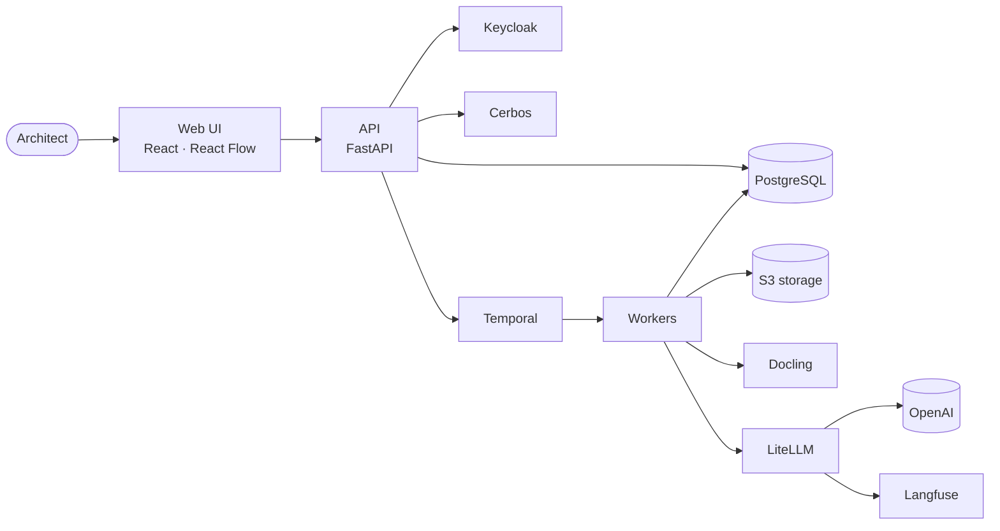

<div align="center">


# ArchTwin

**The living digital twin of your software architecture.**
Know what was designed, what was planned, what the code says and what is actually running — and get told, with evidence, when they drift apart.

[](#-roadmap--status)
[](openspec/)
[](docs/TECHNOLOGIES.md)
[](docs/TECHNOLOGIES.md)
[](docs/architecture/adr/0002-postgresql-canonical-store-and-outbox.md)
[](docs/architecture/adr/0007-temporal-for-all-durable-work.md)
[](docs/architecture/adr/0004-keycloak-cerbos-and-federation.md)
[](docs/ai/AI_ARCHITECTURE.md)

[What it is](#-what-it-is) · [Features](#-features) · [How it works](#-how-it-works) · [Architecture](#-architecture) · [Tech stack](#-tech-stack) · [Roadmap](#-roadmap--status) · [Docs](#-documentation) · [Contributing](#-contributing)

</div>

---

> [!NOTE]
> **This repository currently contains the product and engineering specification** — PRD, architecture, ADRs, threat model and 7 OpenSpec phase changes (38 capabilities · 125 requirements · 250 scenarios). Implementation starts with the walking skeleton in [`openspec/changes/phase-01-foundation`](openspec/changes/phase-01-foundation/). Nothing below is claimed as implemented yet.

## ✨ What it is

Architecture documentation rots the day it is written. Diagrams, ADRs, Jira tickets, code and Kubernetes all evolve separately, and architects find out about drift in production.

ArchTwin closes the **architectural continuity loop**:

```
Design → ADR → plan → issues / commits → runtime observation → drift → review → updated architecture
```

- 🔎 It **discovers** systems, services, APIs, topics, databases and workloads from GitHub/GitLab, Kubernetes, PostgreSQL, Kafka, OpenTelemetry and your documents — read-only.
- 🧾 Every fact carries **evidence**: where it came from, which revision, when it was observed, how confident we are. Missing data is shown as **unknown**, never as "deleted".
- 🗺 It renders **C4 diagrams** you can edit, review, diff and export — and lets you **zoom** from system context into containers and components.
- 🚨 It **detects drift** deterministically between what was decided, what the code says and what is running.
- 🤖 It answers questions like **"How do I connect platform A and B?"** with cited options, trade-offs, diagrams and an ADR draft — without ever changing anything on its own.

## 🧩 Features

### Projects and security
- **Independent projects** with their own people, environments, connectors, baselines and AI budget; cross-project access only through explicit, expiring **federation grants**.
- **Keycloak** single sign-on, **Cerbos** policy-as-code on every read and write (list filtering included), PostgreSQL row-level security as defence in depth.
- **Hash-chained audit log** with an export verifier; envelope-encrypted connector secrets that never reach browsers, logs or prompts.
- **Feature flags** for every optional module, connector and AI operation, with an emergency kill switch — security invariants are never flaggable.

### Discovery and evidence
- Connectors for **GitHub, GitLab, Kubernetes, PostgreSQL/MySQL, Kafka + Schema Registry, OpenAPI, OpenTelemetry service graph, Jira, Taiga** and uploaded documents (Docling), with more planned in the [connector matrix](docs/connectors/CONNECTOR_MATRIX.md).
- Code extraction from declared artifacts first (OpenAPI, AsyncAPI, Helm, Backstage `catalog-info.yaml`, CODEOWNERS), plus tree-sitter detectors and Syft SBOMs — every finding with file, line and commit.
- Webhooks + watches + scheduled reconciliation; partial scans never cause false deletions.

### Living architecture
- One canonical, **temporal** architecture graph: time-travel to any date, diff any two snapshots, approve immutable **baselines**.
- **Diagram studio**: C4 context / container / component, deployment, data-flow and sequence views from the same model; manual layout survives regeneration; Structurizr DSL and Mermaid import/export.
- **Animated C4 zoom**: dive from the system context (L1) into a system's containers (L2) and a container's components (L3), with breadcrumbs and reduced-motion support.
- **Editorial diagram quality**: every generated diagram follows the open-source [diagram-design](https://github.com/cathrynlavery/diagram-design) system — org-branded tokens, at most two focal accents, ≤ 9 primary nodes per view, orthogonal connectors — checked by a linter before export.
- **ADRs** (MADR) with independent approval and immutable history; **living documentation** where every generated sentence cites its evidence.

### Drift and delivery
- **Three-way drift**: desired (baseline/ADR) vs code vs runtime, with `unknown` / `incomplete` states, grace windows and an observe-only rollout to keep false positives down.
- Triage workflow, scoped and expiring suppressions, notifications to email, Slack, Teams or webhooks (Apprise).
- **Traceability** from initiative → issue → PR → commit → build → image digest → running workload: *Done in Jira* is never confused with *deployed*.
- Architecture checks for CI as signed **SARIF** reports — report-only first, blocking only with deterministic rules and owner approval.

### Grounded AI
- Architecture assistant over **scoped evidence only**, with citations validated against an evidence pack; unsupported claims are marked.
- **Choose your model**: `gpt-6-luna` (default), `gpt-6-terra` or `gpt-6-sol`, through LiteLLM; every answer shows which model produced it. Langfuse traces, budgets and evaluations per model.
- **Integration designer** for "connect A and B": at least two options, a trade-off matrix, C4 and sequence diagrams, ADR and task drafts.
- **Blast-radius analysis** and what-if scenarios on isolated branches of the model.
- Proposals only: nothing is applied, written to a tracker or deployed without explicit, authorized approval.

## 🔄 How it works

```mermaid
flowchart LR
  subgraph Sources [read-only sources]
    git[GitHub / GitLab]
    k8s[Kubernetes]
    data[Postgres · Kafka]
    otel[OpenTelemetry]
    docs[Docs · Jira · Taiga]
  end
  Sources --> obs[Immutable observations<br/>origin · revision · freshness · confidence]
  obs --> graph[Temporal architecture graph]
  baseline[Approved baseline + ADRs] --> drift
  graph --> drift[Deterministic drift rules]
  graph --> diagrams[C4 diagrams · docs · exports]
  drift --> triage[Triage · alerts · CI reports]
  graph --> ai[Grounded AI<br/>cited answers & designs]
  ai -. proposals .-> baseline
```

## 🏗 Architecture

A **modular monolith** (FastAPI) plus **Temporal** workers from the same image, with **PostgreSQL** as the only system of record. Everything else is adopted open source.



Key decisions are recorded as ADRs in [`docs/architecture/adr`](docs/architecture/adr/README.md): modular monolith, PostgreSQL + outbox (no Kafka in MVP), three-way evidence model, Keycloak + Cerbos, LiteLLM with selectable models, read-only connectors, Temporal, OpenFeature flags, the diagram-design system with C4 zoom, and *adopt open source before building*.

## 🧰 Tech stack

| Layer | Choices |
|---|---|
| Backend | Python, FastAPI (asyncio), Pydantic v2, SQLAlchemy 2 async, Alembic |
| Data | PostgreSQL (graph tables, JSONB, FTS, pgvector), Valkey, S3-compatible storage (SeaweedFS) |
| Workflows | Temporal, transactional outbox |
| Identity & policy | Keycloak (OIDC + PKCE), Cerbos, OpenFeature, OpenBao (optional KMS) |
| Discovery | githubkit, python-gitlab, kubernetes_asyncio, confluent-kafka, tree-sitter, Syft, Docling, OpenTelemetry |
| Frontend | React 19, Vite, TypeScript, TanStack, shadcn/ui, Tailwind, React Flow, elkjs, Motion |
| Diagrams | diagram-design system, Mermaid & Structurizr (interchange) |
| AI | LiteLLM, Langfuse, OpenAI (`gpt-6-luna` default, `gpt-6-terra`, `gpt-6-sol`) |
| Ops | Docker Compose, Helm, CloudNativePG, Prometheus, Grafana, OpenTelemetry |

Full adopt-vs-build reasoning: [`docs/TECHNOLOGIES.md`](docs/TECHNOLOGIES.md).

## 🗺 Roadmap & status

| Phase | Increment | Milestone | Status |
|---|---|---|---|
| [01](openspec/changes/phase-01-foundation/) | Secure multi-project foundations (walking skeleton) | M1 | 📝 specified |
| [02](openspec/changes/phase-02-connectors/) | Discovery and connected evidence | M1 | 📝 specified |
| [03](openspec/changes/phase-03-architecture/) | Living diagrams, C4 zoom, docs and ADRs | M1 | 📝 specified |
| [04](openspec/changes/phase-04-drift/) | Continuous drift and alerts | M2 | 📝 specified |
| [05](openspec/changes/phase-05-delivery/) | Plans, traceability and CI checks | M2 | 📝 specified |
| [06](openspec/changes/phase-06-intelligence/) | Grounded AI and cross-platform design | M3 | 📝 specified |
| [07](openspec/changes/phase-07-enterprise/) | Enterprise operations and extensibility | M4 | 📝 specified |

Delivery is risk-first: walking skeleton, time-boxed spikes with go/no-go criteria, then thin vertical slices against a reference fixture (the OpenTelemetry Demo on kind). See the [implementation plan](docs/IMPLEMENTATION_PLAN.md).

## 📚 Documentation

| | |
|---|---|
| [Docs index](docs/README.md) | Everything in one place |
| [PRD](docs/PRD.md) | Problem, personas, workflows, non-goals |
| [Solution architecture](docs/architecture/SOLUTION_ARCHITECTURE.md) | Containers, states, persistence, failure behaviour |
| [Implementation plan](docs/IMPLEMENTATION_PLAN.md) | Milestones, spikes, risks, rollback |
| [Threat model](docs/security/THREAT_MODEL.md) | Trust boundaries and controls |
| [AI architecture](docs/ai/AI_ARCHITECTURE.md) | Grounding, model selection, evaluation |
| [Spec index](docs/SPEC_INDEX.md) | All 38 capabilities and requirements |

### Working with the specs

```bash
npm install -g @fission-ai/openspec
openspec list
openspec validate --all --strict --no-interactive
openspec show phase-01-foundation
```

## 🤝 Contributing

Contributions are welcome — ArchTwin is spec-driven, so start with an issue or an OpenSpec change proposal. Read [`CONTRIBUTING.md`](CONTRIBUTING.md) for the workflow and [`AGENTS.md`](AGENTS.md) for the engineering rules that humans and coding agents follow.

## 🙏 Acknowledgements

ArchTwin stands on great open source: Keycloak, Cerbos, Temporal, PostgreSQL, LiteLLM, Langfuse, Docling, tree-sitter, React Flow, elkjs, OpenTelemetry, Structurizr, Mermaid and the [diagram-design](https://github.com/cathrynlavery/diagram-design) system. See [`THIRD_PARTY_NOTICES.md`](THIRD_PARTY_NOTICES.md).

## 📄 License

No license has been chosen yet. Until one is added, all rights are reserved by the author.
