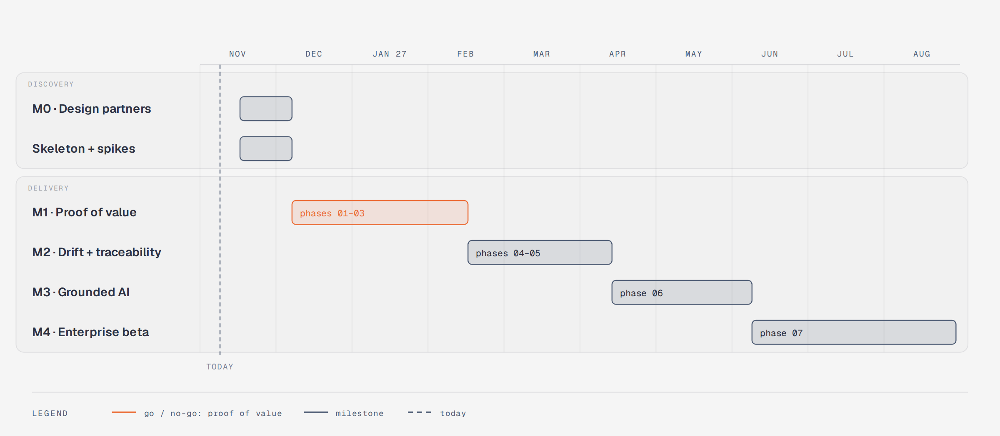

# Implementation plan — risk-first delivery

This plan turns the seven OpenSpec phases into an order of work that **retires the biggest risks first** and produces a demoable, tested product at every milestone. Phase details live in `openspec/changes/phase-*/tasks.md`; this document explains *sequencing and risk*.

## 1. Principles

1. **Walking skeleton first.** In week 1–2 the full stack starts with one command, a user logs in, and CI runs every test layer — before any feature.
2. **Vertical slices, not horizontal layers.** M1 cuts thinly across phases 01–03 (one connector type of each kind → graph → one diagram) instead of finishing phase 01 completely.
3. **Spikes before commitments.** Each technical unknown gets a time-boxed spike with a go/no-go criterion (§3).
4. **Fixture before real systems.** Every connector, rule and AI eval is developed against the reference fixture (OpenTelemetry Demo on kind) with labelled ground truth.
5. **Dark launch.** New modules ship behind flags (OFF), run in observe-only/shadow mode, and are enabled per pilot project.
6. **Read-only before write; report-only before blocking; deterministic before AI.**
7. **Expand → migrate → contract** for every schema change; N-1 compatibility for one release.
8. **Zero-token CI.** A fake LLM mode drives all automated tests; real models run in nightly evals.
9. **Security invariants are tested from day one** (isolation, audit, flag bypass, canary secret) and never flagged off.
10. **Adopt OSS** per `docs/TECHNOLOGIES.md`; custom infrastructure code needs an ADR.

## 2. Milestones

Durations are planning ranges, not commitments. Overlap is expected; each milestone ends with a go/no-go review.

| Milestone | Scope (thin slice) | Demo script | Go/no-go |
|---|---|---|---|
| **M0** | 8–12 architect interviews, sample repos/ADRs/drift stories, permission realities | — | Which wedge (drift vs living diagrams vs traceability) hurts most? |
| **Skeleton** | phase-01 §0, kernel, OIDC, Cerbos (S1), outbox, audit, flags, UI shell | `make up` → login → create project → toggle flag → audit entry | CI green incl. isolation suite |
| **M1** | phase-01 MVP + phase-02 (GitHub, K8s, Postgres, Kafka, OpenAPI, OTel service graph, uploads) + phase-03 (graph, baseline, C4 container diagram with diagram-design system, diff, ADR, Markdown/DSL export) | fixture: connect → discover → C4 container diagram with evidence → compare two commits → approve baseline → export | Design partners return after day one; precision on fixture ≥ agreed threshold |
| **M2** | phase-04 (observe-only → in-app alerts) + phase-05 (GitHub issues links, evidence chain, SARIF report-only) | merge route change → drift finding with evidence; stop connector → UNKNOWN; issue Done but not deployed → unverified | FP rate under threshold; real mismatches found at a pilot |
| **M3** | phase-06 (assistant, model picker, federation, integration designer, blast radius) | "How do I connect A and B?" → 2 options, diagrams, ADR draft, all cited | eval thresholds met; zero leaks in red-team |
| **M4** | phase-07 (Helm/CNPG, restore drills, collaboration, search, plugin SDK, health) | restore drill; 50-project load test | pentest clean; paying pilot interest |

**Decision rule:** if M1 does not show repeat usage, narrow scope to drift + traceability before building further modules.

## 3. Spikes (week 1–3, time-boxed)

| ID | Question | Method | Go criterion | Fallback |
|---|---|---|---|---|
| S1 | Can Cerbos PlanResources → SQLAlchemy cover our list filters safely? | official adapter on project/diagram/ADR policies, fuzz plans | all MVP list endpoints filtered; unknown operators ⇒ deny | allowed-ID prefetch per resource type |
| S2 | Is static extraction accurate enough on real code? | tree-sitter detectors + declared artifacts on fixture + 2 partner repos | precision ≥0.9 on declared artifacts, recall reported | rely on declared artifacts + runtime evidence; lower confidence for inferred |
| S3 | Can static and runtime identities be matched? | image digest ↔ repo, k8s labels ↔ service names on fixture | ≥80% auto-matched, rest in review queue | manual mapping UI first |
| S4 | Does React Flow + elkjs + diagram-design routing stay usable at scale? | 200/2k-node fixtures, orthogonal routing, linter | 200 nodes interactive; 2k aggregated < 4 s | aggregation + overview/detail split (already required by design system) |
| S5 | Docling throughput/resource use | 30-page PDFs, scanned docs | ≤2 min per typical PDF in container limits | queue concurrency 1; scanned docs later |
| S6 | Is OTel service-graph data available/useful? | fixture collector servicegraph connector | runtime `calls` edges for ≥90% of fixture traffic | trace sampling via Jaeger dependencies API |

## 4. Work breakdown per milestone (MVP cut)

**In M1:** RequestContext, OIDC, Cerbos, RLS, outbox, audit chain, flags, UI shell, connector SDK, egress guard, GitHub + K8s + Postgres + Kafka + OpenAPI + OTel adapters, uploads + Docling, observations/freshness, graph builder, baselines, C4 context/container diagrams (diagram-design renderer + linter), diff, MADR ADRs, Markdown + Structurizr DSL export.

**Deferred from M1 (still specified):** org deletion/break-glass, Jira/Taiga, GitLab (if partners use GitHub), Swarm/ArgoCD, PDF/DOCX export, review packs, Structurizr import, component-level views, brand onboarding UI.

## 5. Risk register

| # | Risk | L | I | Mitigation | Early signal |
|---|---|---|---|---|---|
| R1 | Scope (38 capabilities) overwhelms delivery | H | H | thin slices, MVP/Later tags, decision rule | M1 slips > 4 weeks |
| R2 | Noisy/false drift destroys trust | H | H | UNKNOWN/INCOMPLETE semantics, observe-only, grace windows, FP metric per rule | FP rate on fixture > target |
| R3 | Static analysis too inaccurate | M | H | declared artifacts first, runtime corroboration, confidence display (S2) | precision < 0.9 |
| R4 | Cross-project data leak | L | Critical | context-scoped repos, Cerbos, RLS, isolation suites in CI, red-team | any isolation test failure blocks merge |
| R5 | Onboarding friction (permissions, tokens) | H | M | GitHub App, read-only ClusterRole template, scope display, 10-minute fixture quickstart | partners stall at connector setup |
| R6 | Competitors (IcePanel, Backstage, Port) | H | M | wedge on evidence/drift/traceability, interoperate (Structurizr, Backstage import) | partner feedback "we already have X" |
| R7 | AI cost and hallucination | M | M | budgets, citation validator, evals per model, deterministic tools | cost/answer or grounding below target |
| R8 | Operational weight of the stack (Keycloak, Temporal, Langfuse…) | M | M | single Compose, shared Postgres, profiles for optional services | dev setup > 15 min |
| R9 | OSS dependency risk (licence changes, abandonment) | M | M | prefer foundation-backed projects; interfaces around each; Renovate | licence change notices |
| R10 | Diagram quality not good enough | M | H | diagram-design system + linter, overview/detail split, usability sessions | partners redraw diagrams elsewhere |
| R11 | Single-engineer bus factor | H | H | ADRs, OpenSpec specs, runbooks, CI as documentation | — |
| R12 | Model availability/pricing changes | M | M | LiteLLM aliases, eval-gated picker, default Luna | provider deprecation notices |

## 6. Quality gates (every PR / every phase)

- **PR:** lint, types, unit + integration tests, isolation suite, OpenAPI diff check, `openspec validate --strict`, Alembic up/down, secret scan, image scan; spec scenario tests for touched requirements.
- **Phase exit:** all scenarios automated; threat review; NFR measurements recorded; rollback rehearsal; feature flags verified OFF/ON; demo recorded; only then `openspec archive`.

## 7. Rollback playbook

1. Flip the module or provider flag OFF (propagates < 15 s; queued jobs re-check and skip).
2. If code is faulty: redeploy previous image (N-1 compatible schema).
3. If data is faulty: observations are immutable — rebuild graph/findings with the previous builder/rule version; re-normalize from stored raw artifacts.
4. If an external write happened: audit lists it with links for manual revert.
5. Post-incident: ADR or spec update, regression test added.
