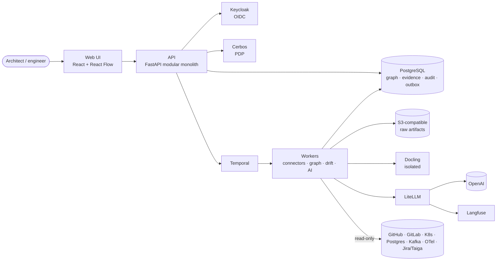

# Solution Architecture — ArchTwin

## 1. Logical architecture
A **modular monolith** ([ADR-0001](adr/0001-modular-monolith-first.md)) owns all authoritative business transactions in a single FastAPI API process; **Temporal** workers built from the same image run every durable/asynchronous job ([ADR-0007](adr/0007-temporal-for-all-durable-work.md)). Isolated containers exist only where isolation is the point: Docling, export renderers, sandboxed code analysis and (phase 07) plugins. PostgreSQL is the system of record. The architecture graph is initially canonical relational data + edge tables + JSONB snapshots; Neo4j and Qdrant are **optional projections** powered by the outbox, never competing authorities ([ADR-0002](adr/0002-postgresql-canonical-store-and-outbox.md)). Technology choices and rejected alternatives: [`docs/TECHNOLOGIES.md`](../TECHNOLOGIES.md).

### Container view

### Logical components
| Domain | Ownership | Inbound/outbound contract |
|---|---|---|
| Organizations & projects | tenancy, scope, environments | project API / domain events |
| IAM/Policy | OIDC validation, Cerbos policy and sharing grants | authorized commands/query predicates |
| Flag service | typed flag catalog, policies, kill switches | evaluation service + cached revision |
| Connectors | provider credentials, cursors, webhooks and reconciliation | adapter SDK, normalized observations |
| Inventory | code/static + runtime + data/messaging discovery | source observations/evidence |
| Architecture model | temporal systems, elements and relationships | canonical graph and baseline snapshots |
| Diagram Studio | view definitions/layouts, C4/sequence rendering | graph query -> versioned view |
| Documentation/ADRs | source-backed drafts, reviews, publication | versioned docs and decisions |
| Drift | desired/code/runtime three-way comparison | deterministic rules -> findings |
| Planning | initiative/milestone/task linkage | external work item sync + evidence |
| Intelligence | architecture Q&A, design options, what-if | scoped retrieval -> LiteLLM -> Langfuse |
| Notifications | project alerts, digests and integrations | outbox -> delivery attempts |
| Audit & operations | evidence, trace logs, exports and SLOs | immutable audit + telemetry |

### Deployment
- **UI**: static React/Vite bundle served by Nginx/Ingress with OIDC PKCE, short-lived tokens, CSP.
- **API**: multiple FastAPI/Uvicorn replicas behind ingress; no session state in process.
- **Workers**: asyncio connector scanners, parser workers, indexers, temporal activity workers. Queue concurrency bounded by org/project/provider.
- **Temporal**: the single runtime for durable work — scans, reconciliation, schedules (Temporal Schedules), digests, approvals and deletions. Runs on the same PostgreSQL in development. The PostgreSQL outbox relay hands domain events to Temporal workflows or in-process handlers.
- **PostgreSQL HA**: schemas for identity metadata, projects, source observations, architecture graph, plans, docs, drift, audit and outbox.
- **Valkey** (Redis-compatible, BSD): transient dedupe, rate limiting and cached flag revisions. Valkey is NOT authoritative for evidence or permissions.
- **S3-compatible object store** (SeaweedFS in Compose; any S3 in production): immutable source files and normalized parses; per-org/project prefixes, references and checksums.
- **Keycloak + Cerbos**: OIDC IDP and independent policy decision point; denial on PDP unavailable for sensitive operations.
- **LiteLLM**: the only upstream model egress; user-selectable `gpt-6-luna` (default), `gpt-6-terra`, `gpt-6-sol`, fallback `gpt-5.6-luna`, embeddings `text-embedding-3-large`, optional later vLLM deployments ([ADR-0005](adr/0005-litellm-langfuse-selectable-models.md)); **Langfuse** receives trace/cost metadata with redaction settings.
- **Optional projections**: Neo4j for deep graph traversal and Qdrant for semantic retrieval, both fully rebuildable from PostgreSQL evidence.

## 2. Architectural states — never merge these accidentally
| State | Source | Authority | Example |
|---|---|---|---|
| **Desired** | approved ADR / architecture baseline | architect-approved intent | service A SHOULD publish Kafka events |
| **Static** | repo scanner at commit SHA | what source code declares | Spring producer publishes `orders.v1` |
| **Observed** | runtime/Kafka/telemetry/K8s at time T | actual observed deployment | consumer B active in prod |
| **Planned** | roadmap and drafts | not yet implemented | broker migration on milestone M3 |
| **External issue** | Jira/Taiga reported status | work management state | story Done |
| **Inferred** | AI or heuristics | hypothesis until corroborated | suspected data flow via queue |

A finding must include relevant evidence and prove its classification. Missing observation due to stale/unreachable source is **UNKNOWN**, not absence.

## 3. Persistence and eventing
- SQLAlchemy async sessions use transaction-scoped service methods; no unrestricted generic repository API that bypasses permission checks.
- Each authoritative command inserts domain updates and an `outbox_event` in one PostgreSQL transaction.
- Async worker reads outbox with SKIP LOCKED, delivers idempotently; uses `{source_id, provider_event_id}` unique keys.
- Source fetch -> immutable raw snapshot -> normalization -> source observation -> canonical element link -> graph version -> drift evaluation -> notifications.
- Connector offsets/checkpoints are committed **after** durable storage, not before; reconcile upstream state periodically.
- Every source observation includes `source_version`, `observed_at`, `ingested_at`, `parser_version`, `hash` and freshness/confidence.

## 4. Graph semantics
See `docs/architecture/DATA_MODEL.md`. Use canonical typed nodes/edges with identity reconciliation rules and separate projections for source/code/runtime/plan/desired. Keep historical model versions and source evidence. Approved baselines cannot be silently overwritten by scans.

## 5. Performance and boundaries
- Query paths: filtering by organization/project/environment and Cerbos policy **before** graph retrieval, caching or LLM context construction.
- Long graph traversals use bounded depth, node cap and time budget; default 3 hops, max configured per role.
- Large scanned artifacts live outside relational rows; store content hashes and extracted text indexes with lifecycle policy.
- Use targeted incremental scans and nightly full reconciliation, not frequent complete repository scans.
- Treat cost as an SLO: LLM completion max tokens, concurrency and spend; connector and browser request budgets.
- Project-owned queues and fair admission prevent one large scan from starving others.

## 6. Security boundaries
Browser -> API has OIDC/JWT checks. API -> Cerbos is internal mTLS in production. API -> source adapter carries a signed *task context*, not browser raw credentials. Worker -> LiteLLM scoped internal key. External connector responses are untrusted. Langfuse telemetry must not leak raw private documents by default. See `docs/security/THREAT_MODEL.md`.

## 7. Diagrams and visualization
- One canonical graph feeds every view (C4 context/container/component, landscape, deployment, data/event flow, sequence).
- All platform-generated diagrams use the editorial **diagram-design** system (MIT): org-skinnable tokens, visual-type routing, ≤2 focal accents, ≤9 primary nodes per view (overview + detail beyond that), orthogonal connectors — enforced by a linter before publish/export ([ADR-0009](adr/0009-diagram-design-system-and-c4-zoom.md)).
- The interactive studio (React Flow + elkjs) uses the same tokens, so what you edit is what you export.
- **C4 zoom navigation:** users zoom from the system context (L1) into a system's containers (L2) and a container's components (L3) with an animated shared-element transition, breadcrumbs and URL state; reduced-motion users get an instant cross-fade.
- Mermaid and Structurizr DSL are interchange formats (import/export), not the platform renderer.

## 8. Major architectural decisions
See [`adr/`](adr/README.md):
- [ADR-0001](adr/0001-modular-monolith-first.md) modular monolith first.
- [ADR-0002](adr/0002-postgresql-canonical-store-and-outbox.md) PostgreSQL canonical store and outbox; projections rebuildable.
- [ADR-0003](adr/0003-three-way-evidence-model.md) three-way evidence model with UNKNOWN semantics.
- [ADR-0004](adr/0004-keycloak-cerbos-and-federation.md) Keycloak + Cerbos and explicit federation.
- [ADR-0005](adr/0005-litellm-langfuse-selectable-models.md) LiteLLM + Langfuse, user-selectable models.
- [ADR-0006](adr/0006-read-only-connectors.md) read-only connectors, approved write-back.
- [ADR-0007](adr/0007-temporal-for-all-durable-work.md) Temporal for durable work.
- [ADR-0008](adr/0008-openfeature-flags.md) OpenFeature flags; core not flaggable.
- [ADR-0009](adr/0009-diagram-design-system-and-c4-zoom.md) diagram-design system and C4 zoom.
- [ADR-0010](adr/0010-adopt-open-source-before-building.md) adopt open source before building.

## 9. Failure cases
| Failure | Expected behavior |
|---|---|
| GitLab/Jira/cluster unavailable | preserve last verified observation; mark stale; continue other projects |
| Webhook missed/out-of-order | idempotent handling + periodic reconcile + cursor checkpoint |
| Cerbos unavailable | fail closed for protected reads and writes; audited degraded mode |
| LiteLLM or OpenAI unavailable | architecture UI, drift and static rules continue; AI functions degrade clearly |
| Langfuse unavailable | bounded telemetry buffering or metadata loss policy; never block critical deterministic drift |
| Neo4j/Qdrant down | fallback to PostgreSQL core; projections rehydrate from snapshots/outbox |
| Large project bursts | provider/project rate limiting; backpressure; age-of-data SLO |
| False positive drift | human triage, time-scoped suppressions, evidence inspection and rule version rollbacks |
| User permission revoked | recheck on live access, jobs, cached results and saved answer re-opening |
