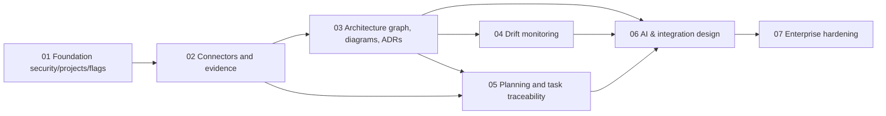

# Capabilities and dependencies

## Deliberately early cross-cutting work
- Authorization/security, project scoping, feature flags, audit and observability begin in phase 1 and are mandatory for every phase.
- Identity and evidence provenance are architectural foundations, not add-ons.
- Connector SDK interface and stable source IDs should land before individual adapters.
- AI's model gateway can be configured early for later usage; phase 6 unlocks user-facing AI functions only when grounded graph evidence exists.
- Define source quality and drift truth table before enabling near-real-time notifications.

## Capability ownership
`organizations`, `project-boundaries`, `identity-policy`, `feature-flags`, `audit-provenance` are separate bounded modules; inventory and graph may share PostgreSQL but not mutable DTOs. Connectors cannot write accepted architecture directly. Drift can read desired, static and observed snapshots but cannot mutate them. Assistant may draft artifact proposals, never directly approve or deploy.
